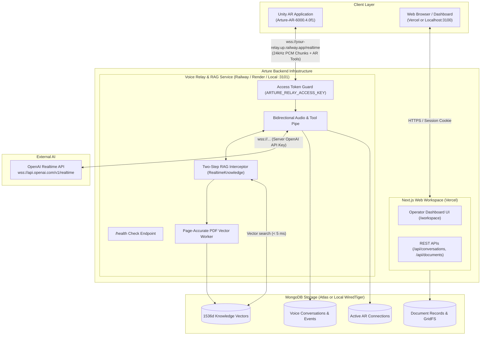
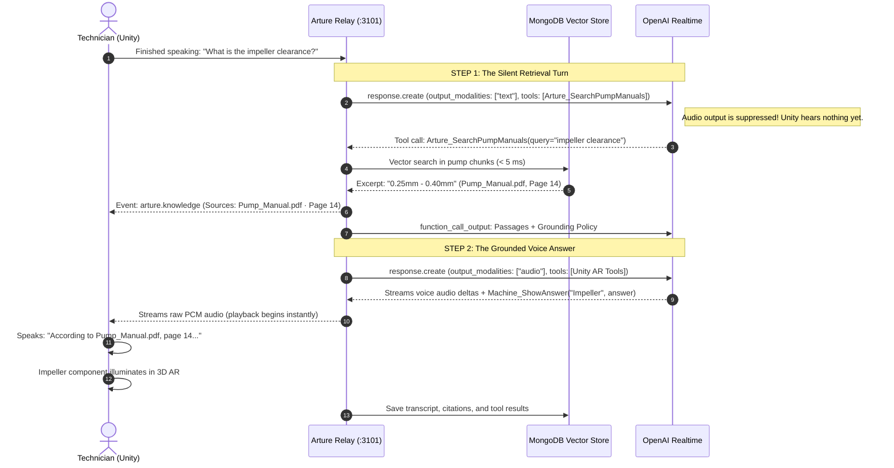

# Arture Web Workspace & Realtime Voice Relay

<div align="left">

[](https://nextjs.org/)
[](https://www.typescriptlang.org/)
[](https://nodejs.org/)
[](https://www.mongodb.com/)
[](https://developers.openai.com/api/docs/guides/voice-websockets)
[](https://railway.app/)
[](https://vercel.com/)
[](https://nodejs.org/api/test.html)

</div>

---

**Arture** is an enterprise spatial operating-system backend that connects industrial machinery, technical engineering manuals, and AR field technicians into a synchronized, grounded workflow.

This repository powers:
1. **The Web Workspace**: An industrial control dashboard managing machine twins, uploaded technical manuals, technician work events, and historical voice sessions.
2. **The Realtime Voice Relay**: A persistent, bi-directional WebSocket server (`:3101`) that tunnels 24 kHz PCM audio between Unity AR and OpenAI Realtime while keeping private credentials off client devices.
3. **The Document Ingestion & Vector RAG Engine**: An automated background worker that extracts text page-by-page from uploaded documents (PDF, DOCX, Markdown, TXT, JSON, CSV) and generates 1536-dimensional embeddings.
4. **The Grounded Voice Orchestrator**: A two-step turn coordinator that forces the AI assistant to search uploaded manuals, quote exact PDF page numbers, and trigger 3D component highlights in AR before speaking.

---

## 📑 Table of Contents

- [The End-to-End Workflow](#-the-end-to-end-workflow)
- [System Architecture & Network Topology](#-system-architecture--network-topology)
- [How Voice RAG Actually Works (The Secret Two-Step Turn)](#-how-voice-rag-actually-works-the-secret-two-step-turn)
- [Repository Structure](#-repository-structure)
- [Local Development Setup](#-local-development-setup)
- [Production Deployment Guide](#-production-deployment-guide)
  - [Deploying the Web Workspace to Vercel](#1-deploying-the-web-workspace-to-vercel)
  - [Deploying the Voice Relay to Railway](#2-deploying-the-voice-relay-to-railway-recommended)
  - [Deploying the Voice Relay to Render](#3-deploying-the-voice-relay-to-render-alternative)
  - [MongoDB Atlas Setup & IP Whitelisting](#4-mongodb-atlas-setup--ip-whitelisting)
- [Configuring the Unity AR Client](#-configuring-the-unity-ar-client)
- [Environment Variables Reference](#-environment-variables-reference)
- [REST & WebSocket API Reference](#-rest--websocket-api-reference)
- [Automated Testing & Live Probes](#-automated-testing--live-probes)
- [Engineering Design Decisions](#-engineering-design-decisions-human-notes)

---

## 🔄 The End-to-End Workflow

```
   1. UPLOAD (Web)           2. ASK (Unity AR)        3. GROUND (Relay RAG)      4. VERIFY (Web)
 ┌──────────────────┐      ┌──────────────────┐     ┌──────────────────┐       ┌──────────────────┐
 │ Admin uploads    │      │ Technician speaks│     │ Relay intercepts │       │ Supervisor opens │
 │ Pump_Manual.pdf  │ ───► │ "What is the     │ ──► │ question, finds  │ ────► │ Voice Sessions:  │
 │ Status: Ready    │      │ seal clearance?" │     │ page 14 in 2ms,  │       │ inspects audio   │
 │ (1536d vectors)  │      │ (24kHz stream)   │     │ speaks citation  │       │ & citations      │
 └──────────────────┘      └──────────────────┘     └──────────────────┘       └──────────────────┘
```

---

## 🏛️ System Architecture & Network Topology



---

## 🧠 How Voice RAG Actually Works (The Secret Two-Step Turn)

OpenAI's Realtime API does not have native document vector retrieval. If an operator asks a technical question directly, the model will hallucinate mechanical clearances or operating temperatures before any retrieval can happen.

To solve this without adding human-perceptible latency, the Arture Relay implements a **hidden two-step turn orchestration**:



- **Speed**: The entire vector lookup completes in **2–5 milliseconds**.
- **Accuracy**: The AI assistant is forced by server prompt policies to quote the document title and physical PDF page.
- **Safety**: If no passages match (or relevance score is $< 0.30$), it falls back gracefully: *"The uploaded manuals do not establish this specification. Please upload the relevant document."*

---

## 🗂️ Repository Structure

```text
arture-appsite/
├── .arture-local/               # (Ignored) Isolated local WiredTiger MongoDB & credentials
├── Dockerfile                   # Default container build for Railway and Render
├── Dockerfile.relay             # Specialized relay container image
├── scripts/
│   ├── check-grounded-voice.ts  # Verification probe: runs live RAG voice query
│   ├── check-voice-relay.ts     # Verification probe: streams real OpenAI voice through relay
│   ├── configure-unity-relay.ts # Detects local LAN IP & configures Unity client
│   ├── db-indexes.ts            # Builds vector and compound indexes in Atlas
│   ├── db-migrate-water-pump.ts # Scopes workspace to pump ATR-DEMO-PUMP-001 safely
│   ├── knowledge-worker.ts      # Standalone background PDF ingestion & vector worker
│   ├── local-workspace.ts       # All-in-one local development orchestrator
│   ├── realtime-relay.ts        # Standalone persistent WebSocket relay process
│   └── relay-service.ts         # Cloud container entrypoint (Relay + Worker + /health)
├── src/
│   ├── app/                     # Next.js App Router
│   │   ├── api/                 # REST endpoints (conversations, documents, app-connections)
│   │   ├── login/               # Authentication page with demo pre-fill & guest access
│   │   └── workspace/           # Main industrial operator dashboard
│   ├── client/components/       # UI Components (Sessions viewer, PDF Knowledge panel, Dashboard)
│   └── lib/
│       ├── conversation-recorder.ts # Asynchronous turn & transcript persistence
│       ├── demo-machine.ts          # Universal water pump & demo asset scoping
│       ├── env.ts                   # Auto-inferring environment validation
│       ├── knowledge.ts             # PDF parser, token chunking, and embedding generation
│       ├── realtime-knowledge.ts    # Two-step turn RAG interceptor & grounding prompt
│       └── realtime-relay.ts        # In-memory WebSocket router & authentication guard
└── tests/                       # 26 automated unit & integration tests
    ├── conversations.test.ts    # Turn ordering, deduplication, and worker matching
    ├── knowledge.test.ts        # PDF parsing, page numbering, and vector search
    ├── realtime-knowledge.test.ts # RAG interception, timeouts, and fallbacks
    ├── realtime-relay.test.ts   # Audio streaming, credential hiding, and disconnects
    └── water-pump.test.ts       # Database migration, scoping, and isolation
```

---

## 🚀 Local Development Setup

The local mode runs an isolated persistent MongoDB instance (`wiredTiger`), the Next.js frontend, the voice relay, and the document worker together in a single command. It **never touches or risks any shared remote database**.

```powershell
# 1. Install dependencies
npm install

# 2. Build Next.js
npm run build

# 3. Start local workspace
npm run start:local
```

Once running:
- **Web Dashboard**: Open `http://localhost:3100/login`.
- **Login Credentials**: Pre-filled automatically, or view `.arture-local/login.json`.
- **Voice Relay**: Listening on `ws://localhost:3101/realtime`.
- **Persistence**: All uploads, vector embeddings, and voice sessions persist in `.arture-local/mongodb` across computer restarts.

*(For active UI development with hot-reloading, run `npm run dev:local` instead).*

---

## ☁️ Production Deployment Guide

In production, the architecture splits cleanly between **stateless web hosting** (Vercel) and **persistent WebSocket hosting** (Railway or Render):

### 1. Deploying the Web Workspace to Vercel

The web dashboard and REST APIs run on Vercel.

1. Connect `arture-appsite` repository to [Vercel](https://vercel.com).
2. In Project Settings → **Environment Variables**, add:
   ```env
   ARTURE_MONGODB_URI=mongodb+srv://<user>:<password>@cluster0.mongodb.net/?appName=Cluster0
   ARTURE_MONGODB_DB=test
   ARTURE_APP_URL=https://arture-appsite.vercel.app
   ARTURE_AUTH_SECRET=a-secure-random-32-character-secret
   ARTURE_DEMO_MODE=true
   ARTURE_GUEST_LOGIN_ENABLED=true
   ```
3. Deploy branch `master`.

> [!NOTE]
> Vercel Serverless Functions do not support long-lived full-duplex WebSocket connections needed for Realtime voice. Do **not** point Unity at Vercel. Unity connects to Railway or Render.

---

### 2. Deploying the Voice Relay to Railway (Recommended)

Railway runs the persistent WebSocket relay and document vector worker via container.

1. Log into [Railway](https://railway.app/) and click **New Project → Deploy from GitHub repo**.
2. Select your fork/repo: `th-efool/arture-appsite`, branch `master`.
3. Open the created service → **Variables**, and configure:
   ```env
   ARTURE_MONGODB_URI=mongodb+srv://<user>:<password>@cluster0.mongodb.net/?appName=Cluster0
   ARTURE_MONGODB_DB=test
   ARTURE_OPENAI_API_KEY=sk-proj-...
   ARTURE_RELAY_ACCESS_KEY=your-chosen-relay-secret-at-least-24-chars
   ARTURE_REALTIME_MODEL=gpt-realtime-2.1-mini
   ARTURE_KNOWLEDGE_MODE=vector
   ARTURE_KNOWLEDGE_VECTOR_BACKEND=atlas
   ARTURE_DEMO_MODE=true
   ARTURE_APP_URL=https://arture-appsite.vercel.app
   ```
4. In **Settings**:
   - **Healthcheck Path**: `/health`
   - In **Networking**: Click **Generate Domain** (e.g. `arture-relay-production.up.railway.app`).
5. Verify deployment:
   ```
   https://<your-railway-domain>/health
   ```
   *Should return HTTP 200: `{"ok":true,"service":"arture-relay"}`.*
6. Unity WebSocket endpoint is:
   ```
   wss://<your-railway-domain>/realtime
   ```

---

### 3. Deploying the Voice Relay to Render (Alternative)

Render can also host the voice relay container using the committed `render.yaml` or `Dockerfile`:

1. In [Render Dashboard](https://dashboard.render.com/), choose **New → Web Service**.
2. Connect `arture-appsite`, select **Docker** as the runtime.
3. Configure the same environment variables as above.
4. Set Health Check Path to `/health`.
5. Unity WebSocket endpoint will be:
   ```
   wss://<your-service-name>.onrender.com/realtime
   ```

---

### 4. MongoDB Atlas Setup & IP Whitelisting

Both Vercel and Railway/Render need access to your MongoDB Atlas cluster:

1. **Network Access**: Go to [MongoDB Atlas](https://cloud.mongodb.com/) → **Network Access**.
   - Click **Add IP Address**.
   - Select **Allow Access From Anywhere** (`0.0.0.0/0`).
   - *Why?* Cloud platforms (Railway, Render, Vercel) use dynamic outbound IP addresses. Without `0.0.0.0/0`, connections will fail with `Server selection timed out after 5000 ms`.
2. **Database Resilience**: 
   - You **do not** need to create new databases or rename them. Setting `ARTURE_MONGODB_DB=test` (or omitting it) will automatically connect to your default database.
   - The Centrifugal Water Pump (`ATR-DEMO-PUMP-001`) and default technician roster self-heal and display for **every user account** automatically.

---

## 📱 Configuring the Unity AR Client

To connect your Unity AR project to the local or cloud relay:

### Option A: Automatic Configuration via Script

Update your `.env.local` with your target relay:
```env
# For Local Dev:
ARTURE_RELAY_URL=ws://127.0.0.1:3101/realtime
ARTURE_RELAY_DEVICE_URL=ws://192.168.1.150:3101/realtime
ARTURE_RELAY_ACCESS_KEY=your-relay-secret

# OR For Cloud (Railway):
ARTURE_RELAY_URL=wss://your-railway-service.up.railway.app/realtime
ARTURE_RELAY_DEVICE_URL=wss://your-railway-service.up.railway.app/realtime
ARTURE_RELAY_ACCESS_KEY=your-relay-secret
```

Then run:
```powershell
npm run relay:configure-unity
```

This updates `Assets/Resources/ArtureRelayConnection.json` in the Unity repository directly:
```json
{
  "url": "wss://your-railway-service.up.railway.app/realtime",
  "deviceUrl": "wss://your-railway-service.up.railway.app/realtime",
  "accessToken": "your-relay-secret",
  "assetCode": "ATR-DEMO-PUMP-001"
}
```

### Option B: Direct Unity Setup
Open Unity → `Assets/Resources/ArtureRelayConnection.json` and paste your WebSocket URL and token directly.

---

## ⚙️ Environment Variables Reference

| Variable | Type | Description | Default |
| :--- | :--- | :--- | :--- |
| `ARTURE_MONGODB_URI` | `string` | MongoDB Atlas or local connection URI. | Auto-managed in local mode |
| `ARTURE_MONGODB_DB` | `string` | Target database name. Auto-inferred if omitted. | `test` |
| `ARTURE_OPENAI_API_KEY` | `string` | Private server-side OpenAI key. **Never exposed to Unity.** | `""` |
| `ARTURE_RELAY_ACCESS_KEY` | `string` | Token required by Unity client to authenticate with relay. | Auto-generated in local mode |
| `ARTURE_RELAY_PORT` | `number` | Port for the WebSocket realtime voice relay. | `3101` (or `$PORT` on cloud) |
| `ARTURE_REALTIME_MODEL` | `string` | OpenAI Realtime model ID. | `gpt-realtime-2.1-mini` |
| `ARTURE_APP_URL` | `string` | Base web application URL. Inferred on Vercel/Railway. | `http://localhost:3100` |
| `ARTURE_AUTH_SECRET` | `string` | Encryption secret for user session cookies. | Fallback provided |
| `ARTURE_KNOWLEDGE_MODE` | `string` | `vector` (OpenAI embeddings) or `keyword` (offline text index). | `vector` |
| `ARTURE_KNOWLEDGE_VECTOR_BACKEND` | `string` | `local` (in-process exact scoring) or `atlas` (Atlas Vector Search). | `local` |
| `ARTURE_DEMO_MODE` | `boolean`| Universal demo mode; scopes workspace to pump `ATR-DEMO-PUMP-001`. | `true` |
| `ARTURE_GUEST_LOGIN_ENABLED` | `boolean`| Enables one-click guest access on `/login`. | `true` |

---

## 📡 REST & WebSocket API Reference

### Realtime Voice WebSocket (`wss://<host>/realtime`)
- **Authentication**: `Authorization: Bearer <ARTURE_RELAY_ACCESS_KEY>`
- **Query Params**: `assetCode=ATR-DEMO-PUMP-001`
- **Supported Client Events**:
  - `input_audio_buffer.append`: Streams Base64 24kHz PCM microphone chunks from Unity.
  - `arture.identify`: Identifies field technician by phone number (`{"type":"arture.identify","phone":"+91..."}`).
  - `response.create`: Triggers assistant turn.
  - `response.cancel`: Immediately interrupts ongoing assistant speech.
  - `arture.session.end`: Gracefully closes the session and marks it Completed in database.

### REST Endpoints
- `GET /health`: Container health check probe for Railway and Render.
- `GET /api/app-connections`: Live status and heartbeat timestamps of active Unity AR headsets/tablets.
- `GET /api/conversations?machineId=<id>`: Paginated list of recorded voice sessions.
- `GET /api/conversations/<id>`: Full transcript history, cited passages, and AR tool outcomes for a session.
- `POST /api/documents`: Uploads a technical manual PDF to GridFS and queues vector ingestion.
- `POST /api/knowledge/search`: Performs semantic vector search over uploaded manuals returning ranked passages with page citations.

---

## 🧪 Automated Testing & Live Probes

### 1. Complete Automated Test Suite (26 Tests)
Run all unit and integration test suites:
```powershell
npm test
```
- `tests/realtime-relay.test.ts`: Authenticated WebSocket streaming, audio passthrough, backpressure, and provider failures.
- `tests/realtime-knowledge.test.ts`: Two-step turn RAG orchestration, grounding prompt boundaries, and search timeouts.
- `tests/conversations.test.ts`: Transcript deduplication, asynchronous turn ordering, and worker matching.
- `tests/knowledge.test.ts`: PDF text parsing, page number preservation, and vector similarity ranking.
- `tests/water-pump.test.ts`: Water pump database migration and data isolation.

### 2. Live Connection Probes
With the relay service running, execute live end-to-end diagnostics:

- **Raw Audio Pipeline Check**:
  ```powershell
  npm run relay:check
  ```
  *Sends a synthetic audio challenge and confirms that real PCM audio bytes stream back from OpenAI through the relay.*

- **Live Document Grounding (RAG) Check**:
  ```powershell
  npm run relay:check:knowledge -- --allow-no-sources
  ```
  *Asks a machine question, triggers the manual search, prints citations, and validates spoken audio output.*

---

## 💡 Engineering Design Decisions (Human Notes)

> *"Why run a custom WebSocket relay instead of letting Unity talk directly to OpenAI?"*
> 
> 1. **Client Security**: Unity binaries can be decompiled in minutes using tools like dnSpy or IL2CPP inspectors. Hardcoding an OpenAI API key in a client build is an immediate credential leak.
> 2. **Grounded Factuality**: The OpenAI Realtime API cannot search uploaded PDFs on its own. By controlling the WebSocket relay, we intercept the user's question, run an indexed vector search in MongoDB in **2 ms**, and inject the exact manual page number into the model's instructions *before* it begins speaking.
> 3. **Industrial Auditability**: In safety-critical maintenance, supervisors must verify what instructions were given to field technicians. Our relay acts as an immutable flight recorder, saving every query, passage cited, and component highlighted to MongoDB.

---

<div align="center">
Engineered with precision for spatial computing and industrial operations.
</div>
