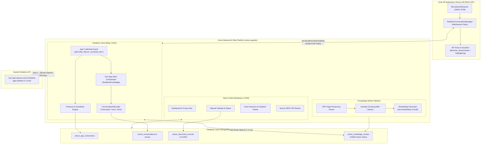

# Arture Web Workspace & Realtime Voice Relay

AI spatial operating-system platform for industrial maintenance, digital twins, and guided machine operations. 

This repository houses the **Next.js web workspace**, the persistent **WebSocket realtime voice relay**, the **PDF document ingestion and vector RAG pipeline**, and the **durable conversation recording engine** for the Centrifugal Water Pump digital twin (`ATR-DEMO-PUMP-001`).

---

## Architecture



---

## Key Features

1. **Water Pump Focused Workspace (`ATR-DEMO-PUMP-001`)**:
   - Single authoritative machine identifier shared across Unity AR, uploaded documents, voice sessions, and maintenance records.
   - Preserves technician directory records and unrelated collections during migration.
2. **Server-Side Voice Relay (`ws://localhost:3101/realtime`)**:
   - Routes voice audio without exposing the OpenAI API key to the client.
   - Low-latency bi-directional streaming for 24 kHz PCM audio.
   - Heartbeat tracking with live connection indicators on the web dashboard.
3. **Document Ingestion & Vector RAG Pipeline**:
   - Ingests text PDFs via GridFS with page-accurate extraction (preserving physical PDF page numbers).
   - Generates 1536-dimensional embeddings (`text-embedding-3-small`) stored in MongoDB.
   - Supports both local in-memory exact cosine similarity and MongoDB Atlas vector search.
4. **Two-Step Voice Grounding**:
   - Intercepts the user's spoken question before audio generation starts.
   - Formulates a targeted search query and retrieves the relevant manual passages in **< 5 ms**.
   - Injects passages and citations (`[S1]`, `[S2]`) with a strict grounding prompt: answers cite the document name and physical page.
   - Signals Unity to highlight the target component and attach citation labels in AR.
5. **Auditable Conversation Sessions**:
   - Captures user transcripts, assistant transcripts, manual citations, duration, worker identification, and AR tool outcomes.
   - Visible in real-time under **Water Pump → Voice Sessions** on the website.

---

## Project Structure

```text
arture-appsite/
├── .arture-local/               # (Ignored) Persistent local MongoDB, login.json, and relay keys
├── scripts/
│   ├── check-grounded-voice.ts  # Verification probe testing RAG retrieval and voice generation
│   ├── check-voice-relay.ts     # Verification probe testing raw audio streaming through relay
│   ├── configure-unity-relay.ts # Provisions Unity Resources config with detected LAN IP & token
│   ├── db-indexes.ts            # Creates indexes for MongoDB Atlas collections
│   ├── db-migrate-water-pump.ts # Scopes database to Centrifugal Water Pump without data loss
│   ├── db-seed.ts               # Provisions admin user account
│   ├── db-seed-sample.ts        # Seeds sample technicians and baseline pump record
│   ├── knowledge-worker.ts      # Persistent background worker for PDF chunking and embedding
│   ├── local-workspace.ts       # All-in-one local runner (MongoDB + Next.js + Relay + Worker)
│   ├── realtime-relay.ts        # Standalone persistent WebSocket voice relay server
│   └── validate-env.ts          # Validates environment configuration
├── src/
│   ├── app/                     # Next.js App Router (pages & API endpoints)
│   │   ├── api/
│   │   │   ├── app-connections/ # Live AR app connection status
│   │   │   ├── conversations/   # Session viewer history and transcript pagination
│   │   │   ├── documents/       # PDF upload, download, retry, and deletion
│   │   │   ├── knowledge/       # RAG semantic vector search endpoint
│   │   │   ├── machines/        # Machine details and CRUD operations
│   │   │   └── workers/         # Technician lookup by phone number
│   │   ├── login/               # Authentication page with demo autofill & guest access
│   │   └── workspace/           # Main industrial operator dashboard
│   ├── client/
│   │   └── components/          # React components (Dashboard, Sessions, DocumentKnowledge)
│   └── lib/
│       ├── conversation-recorder.ts # Deduplication, turn tracking, and MongoDB persistence
│       ├── knowledge.ts             # PDF extraction, chunking, and embedding logic
│       ├── realtime-knowledge.ts    # Two-step turn RAG interceptor and grounding policy
│       └── realtime-relay.ts        # WebSocket upgrade handler, auth guard, and audio pipe
└── tests/
    ├── conversations.test.ts    # Tests for session recording and transcript ordering
    ├── knowledge.test.ts        # Tests for PDF extraction, chunking, and vector ranking
    ├── realtime-knowledge.test.ts # Tests for two-step RAG voice interception and fallbacks
    ├── realtime-relay.test.ts   # Tests for audio streaming, credential protection, and tools
    └── water-pump.test.ts       # Integration tests for workspace migration and persistence
```

---

## Quickstart

### Mode 1: Local Offline Development (Recommended for Hackathon)

Run the entire ecosystem locally with a persistent, isolated MongoDB instance, the Next.js frontend, the voice relay, and the document worker together:

```powershell
npm install
npm run build
npm run start:local
```

1. Open `http://localhost:3100/login`.
2. Login credentials are saved in `.arture-local/login.json` (and automatically pre-filled in demo mode).
3. The voice relay listens on `ws://localhost:3101/realtime`.
4. Uploaded manuals, vectors, and voice session transcripts persist in `.arture-local/mongodb` across restarts.

*(For active frontend development with hot-reloading, use `npm run dev:local` instead).*

---

### Mode 2: Remote / Cloud Deployment (MongoDB Atlas & Production)

When connecting to MongoDB Atlas and hosting in the cloud:

1. Copy `.env.example` to `.env.local` and configure your credentials:
   ```env
   ARTURE_MONGODB_URI="mongodb+srv://<user>:<password>@cluster0.mongodb.net/?retryWrites=true&w=majority"
   ARTURE_MONGODB_DB="arture_production"
   ARTURE_ALLOW_SHARED_DATABASE="true"
   ARTURE_OPENAI_API_KEY="sk-proj-..."
   ARTURE_RELAY_ACCESS_KEY="random-secure-token-minimum-32-characters"
   ARTURE_KNOWLEDGE_MODE="vector"
   ARTURE_KNOWLEDGE_VECTOR_BACKEND="atlas"
   ```
2. Initialize database indexes:
   ```powershell
   npm run db:indexes
   npm run db:migrate:water-pump
   ```
3. Start the three persistent services (in separate processes or container instances):
   - **Next.js Web App**: `npm run start` (port 3100)
   - **Voice Relay**: `npm run relay` (port 3101)
   - **Document Knowledge Worker**: `npm run knowledge:worker`

---

## Environment Variables Reference

| Variable | Description | Default |
| :--- | :--- | :--- |
| `ARTURE_OPENAI_API_KEY` | Server-side OpenAI API key (never sent to Unity or browser). | `""` |
| `ARTURE_RELAY_ACCESS_KEY` | Secret app token used by Unity to authenticate with the relay (min 24 chars). | Auto-generated in local mode |
| `ARTURE_RELAY_PORT` | Port for the WebSocket voice relay. | `3101` |
| `ARTURE_REALTIME_MODEL` | Pinned OpenAI Realtime model name. | `gpt-realtime-2.1-mini` |
| `ARTURE_MONGODB_URI` | MongoDB connection connection string. | Local memory/disk in local mode |
| `ARTURE_MONGODB_DB` | MongoDB database name (must be prefixed with `arture_` unless shared allowed). | `arture_local_demo` |
| `ARTURE_ALLOW_SHARED_DATABASE` | Required if connecting to a database not named `arture_*`. | `false` |
| `ARTURE_KNOWLEDGE_MODE` | Knowledge indexing mode: `vector` (embeddings) or `keyword` (text index). | `vector` |
| `ARTURE_KNOWLEDGE_VECTOR_BACKEND`| Vector backend: `local` (in-process exact scoring) or `atlas` (Atlas Vector Search). | `local` |
| `ARTURE_DEMO_MODE` | Enables demo conveniences like prefill and single-pump view. | `true` |
| `ARTURE_GUEST_LOGIN_ENABLED` | Allows read-only guest exploration via the **Log in as guest** button. | `true` |

---

## Configuring the Unity Client

To sync the backend relay address and access credentials with the Unity project:

```powershell
npm run relay:configure-unity
```

This scans your local network interfaces, determines your machine's LAN IP, and updates `Assets/Resources/ArtureRelayConnection.json` in the Unity repository (`../Arture-AR-6000.4.0f1`).

---

## Verification & Testing

### Automated Test Suite
Run all unit and integration tests across the relay, RAG pipeline, conversation recorder, and database migration:

```powershell
npm test
```

Individual test suites:
- `npm run test:relay`: Tests WebSocket authentication, streaming audio passthrough, tool continuations, and provider error handling.
- `npm run test:voice-knowledge`: Tests the two-step turn RAG interception, grounding policy injection, and fallback handling.
- `npm run test:conversations`: Tests conversation deduplication, turn ordering, and worker matching.
- `npm run test:knowledge`: Tests PDF text extraction, physical page mapping, chunk overlap, and vector similarity ranking.
- `npm run test:integration`: Tests water pump database migration, authentication, and REST endpoints.

### Live Connection Probes
With the local workspace running (`npm run start:local`):

1. **Verify Raw Audio Stream**:
   ```powershell
   npm run relay:check
   ```
   *Sends a synthetic request through the relay and validates that real PCM voice audio bytes return from OpenAI.*

2. **Verify Document Grounded Voice (RAG)**:
   ```powershell
   npm run relay:check:knowledge -- --allow-no-sources
   ```
   *Executes a live query through the relay, triggers the manual search, returns citations, and logs the audio response.*

---

## Code Quality & Standards

Ensure all TypeScript types and ESLint rules pass cleanly:

```powershell
npm run lint
npm run typecheck
```
